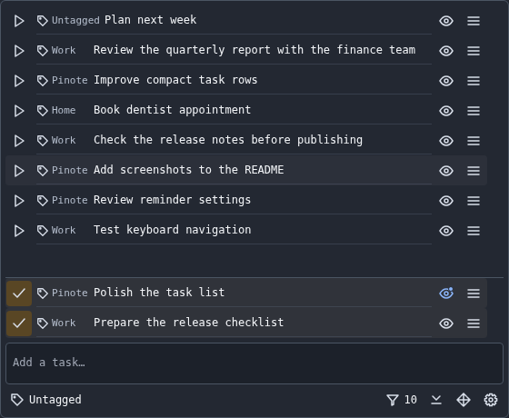
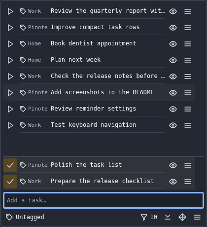

# pinote

Pinned desktop reminders with a small `note` CLI, stable IDs, and durable history.
Linux/i3 first, with Dunst notifications and an Electron desktop frontend for
editing, tags, progress, scheduled reminders, and archived tasks. Electron and
the shared CLI/backend use Node.js; Python remains only as a legacy CLI and test
reference. Electron runs as a separate process, not a service.

## See it in action



*Electron on Linux/i3 with sample tasks, customized row actions, and a light hover
highlight on “Add screenshots to the README”. [Install and controls](docs/electron.md).*

<details>
<summary>Compact Electron layout with default actions</summary>



*Rows stay single-line at 33px high. Separators follow the text/tag area;
hover does not move controls or replace task-state colors.*

</details>

**Desktop workflow:** capture → start → edit → complete. Completed tasks remain
recoverable from Archive.

## Install

Requires **Node.js 22.19+**, npm, Linux `flock` (util-linux), and GNU `date` for local reminder times. From a checkout:

```sh
npm --prefix backend ci --ignore-scripts
npm --prefix backend run build
./backend/bin/note --help
# Optional: install the built CLI on PATH:
npm install -g ./backend
```

Keep npm's global bin directory on `PATH`, or use `./backend/bin/note` directly.
Dunst (`dunstify`), a graphical session, and session D-Bus are needed only for
notifications; terminal commands work without Dunst. Installation never changes
your shell, desktop configuration, or existing reminders.

For upgrades and legacy Python compatibility, see the [CLI guide](docs/usage.md#install).

### Electron desktop frontend

Electron uses the Node backend and the existing task database, with no Python
requirement or data conversion. Installing or building Electron does not change
desktop startup or configuration. Requires Node.js 22.19+. **Menu (cog) → Switch
to Node backend…** can explicitly switch an existing CLI/desktop installation,
with backups and rollback. See [Electron installation, switching, and limitations](docs/electron.md).
Its add-task input and task editor style Markdown source and assist title/bullet
newlines. Only Linux/X11/i3 is a validation target.

## Use

```sh
note "check backups"                     # save and refresh the Dunst reminder
note                                    # list active notes
note list --json                        # machine-readable tasks for integrations
note start 2                            # mark a task in progress
note done 2                             # complete a task
note rm 3                               # archive, never erase
note restore 3                          # restore a task or clear its progress
note schedule 2 "2030-09-18 14:30"        # use a future local date/time
note reminders                          # list scheduled tasks
note history 3                          # inspect retained history
note --no-notify "GUI-only reminder"     # save without refreshing Dunst
```

See [Electron controls](docs/electron.md#controls) for desktop actions and row
settings, or the [CLI and data guide](docs/usage.md) for full commands, Markdown
import/export, and scheduling rules.

### Pi integration

The [pi-note extension](pi/README.md) gives each Pi session native task menus,
footer status, suggestions and fresh selected-task context. It reads and writes
the local notes through the `note` CLI; no service, token or network listener is
involved. Tasks, tags and Markdown handoff fields are shared with the desktop and
other sessions, while task selection remains conversation-specific.

Install it with `pi install npm:pi-note` or `pi install ./pi`, then open **`/pinote`**.
Completion preserves the conversation and draft, except that completing the
launched task in a dedicated **Start in Kitty…** session exits Pi and closes its
tab. Completion never runs Git commands.

Requires Pi 1.4.0+, Node.js 22.19+ and the Node `note` CLI on PATH. Pinote
Electron runs optional [field watchers](pi/FIELD_EVENTS.md) while it is open.
Users of the former HTTP service should follow the
[migration steps](pi/README.md#migration).

## Important constraints

- **Reminders are not wake-up alarms.** Due tasks return while the GUI is open,
  when it next opens/resumes, or when a `note` command runs. There is no timer
  service or automatic Dunst notification. GUI changes do not refresh Dunst.
- IDs and history are retained. Completion/deletion is recoverable; closing the
  checklist does not complete tasks. Its first-launch filter is **Untagged**; later
  launches restore your filter, so tagged tasks may be hidden until you change it.
- Data is saved before notification delivery. Do not repeat an add just because
  Dunst failed. Quote shell metacharacters; use `note add "done"` for reserved names.
- Notes default to `~/.local/share/pinote/notes.db`; logs to
  `~/.local/state/pinote/app.log` (XDG overrides supported). Data stays local but
  is **not encrypted**, and desktop notifications may remain in Dunst history.

### Backups and upgrades

**Markdown exports are not backups:** they omit IDs, tags, schedules, agent fields,
project selections, and history.

Close Electron and stop CLI writes before copying `notes.db` and the `electron/`
state directory beside it. See [backup details](docs/usage.md#data-privacy-and-backup).

Back up before upgrading, and update both the CLI and Electron together.
`note` versions before 0.25.0 cannot read schema 8. See the
[upgrade guide](docs/usage.md#upgrading-for-scheduled-reminders).

## Validation

From the repository root:

```sh
npm --prefix backend ci --ignore-scripts
npm --prefix backend run check && npm --prefix backend run build
uv sync --locked                  # legacy reference and compatibility tests
npm --prefix backend test
uv run ruff check . && uv run ruff format --check .
uv run pytest -m 'not gui'
xvfb-run -a dbus-run-session -- uv run pytest -m gui --run-gui
uv build
npm --prefix pi ci --ignore-scripts && npm --prefix pi test
```

Dunst tests require the [documented desktop tools](docs/development.md) and always
run under Xvfb with a private D-Bus session. Tests use temporary storage.
[Electron validation](docs/development.md#electron-frontend) includes sandboxed,
isolated Xvfb/i3 end-to-end and packaged-app checks.

## License

[MIT](LICENSE).
