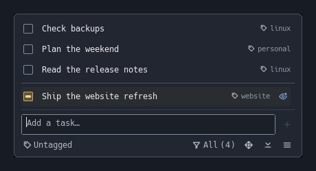
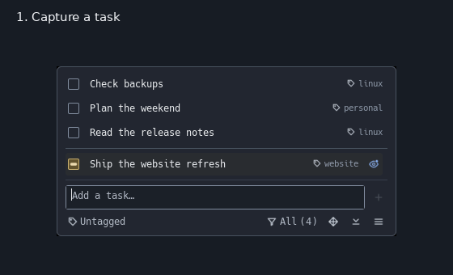

# pinote

Pinned desktop reminders with a small `note` CLI, stable IDs, and durable history.
Linux/i3 first: use a persistent Dunst notification or the optional GTK checklist
for editing, tags, progress, scheduled reminders, and archived tasks. The CLI has
no Python runtime dependencies; the GUI is a separate process, not a service.

## See it in action



*GTK checklist on Linux/i3 with sample tasks.*

**Desktop workflow:** capture → start → edit → complete. Completed tasks remain
recoverable from Archive.

<details>
<summary>Watch the desktop workflow (9-second demo)</summary>



[View a still image instead](docs/images/workflow-still.png).

</details>

## Install

Requires **Python 3.11+**. From a checkout:

```sh
uv tool install .              # or: pipx install .
note --help
```

Keep your installer's tool bin directory (usually `~/.local/bin`) on `PATH`.
Dunst (`dunstify`), a graphical session, and session D-Bus are needed only for
notifications; terminal commands work without Dunst. Installation never changes
your shell, desktop configuration, or existing reminders.

For installation without uv/pipx and local upgrades, see the [CLI guide](docs/usage.md#install).

### Optional GTK checklist

On Debian, use a separate environment with the system GTK bindings, not the
isolated CLI interpreter. Run from the checkout:

```sh
sudo apt install python3-gi gir1.2-gtk-3.0  # only if missing
uv venv --python /usr/bin/python3 --system-site-packages .venv-gui
uv pip install --python .venv-gui/bin/python -e '.[gui]'
.venv-gui/bin/pinote-gui
```

The GUI and CLI share the same database. [GUI setup and controls](docs/gui.md)
cover non-uv installation, i3 login startup, filtering, editing, and configuration.
After GUI source changes, use `./scripts/restart-pinote.sh`; it preserves the
running instance's workspace and leaves a stopped GUI stopped.

## Use

```sh
note "check backups"                     # save and refresh the Dunst reminder
note                                    # list active notes
note list --json                        # machine-readable tasks for integrations
note start 2                            # mark a task in progress
note done 2                             # complete a task
note rm 3                               # archive, never erase
note restore 3                          # restore a task or clear its progress
note schedule 2 "2030-09-18 14:30"        # use a future local date/time
note reminders                          # list scheduled tasks
note history 3                          # inspect retained history
note --no-notify "GUI-only reminder"     # save without refreshing Dunst
```

### GUI controls

- **Add:** press **Enter** or **+**. Unfinished input is restored when reopened.
- **Task actions:** right-click task text to change its state, edit, tag, or schedule
  it. Unfinished edits are restored when reopened and remain drafts until saved.
- **Window size:** drag any edge or corner; width and height survive restarts.
- **Menus:** the bottom menu opens reminders, the archive, and tag management.
- **Tags:** the dropdown below the input tags new tasks. Tags stay saved even
  without tasks. Manage tags can set a default folder for **Start in Kitty…**;
  otherwise, choose a folder when starting.
- **Filters:** the separate funnel control selects one or more tags to view
  together and shows the matching task count.

For full commands, Markdown import/export, and scheduling rules, see the
[CLI and data guide](docs/usage.md).

### Pi integration: shared host/VM tasks

The [pi-note extension](pi/README.md) connects directly to a
[standalone Pinote HTTP service](pi/mcp/README.md), without an MCP gateway.

```text
Host Pi ─┐
         ├─ HTTPS → Pinote service → shared notes
VM Pi ───┘
```

Run the service on the machine holding your notes; each Pi client gets native
task menus, footer status, suggestions and fresh selected-task context. Tasks,
tags and Markdown handoff fields are shared, while task selection remains
conversation-specific. The agent's file editing and other tools stay on its own
machine. Neither Python nor a database mount is needed on VM clients.

Install the client with `pi install npm:pi-note` or `pi install ./pi`, configure
the service endpoint and private bearer token, then open **`/pinote`**.
Completion preserves the conversation and draft, except that completing the
launched task in a dedicated **Start in Kitty…** session exits Pi and closes its
tab. A service restart preserves notes; clients reconnect without replaying writes.

Requires Pi 1.4.0+ and Node.js 22.19+; the service also needs Python 3.11+.
Use HTTPS or a trusted private VPN, never a public unauthenticated listener.
The existing [local-only CLI extension](pi/LOCAL.md) remains available explicitly;
load only one Pinote extension. Existing gateway users should follow the
[migration steps](pi/README.md#migration).

## Important constraints

- **Reminders are not wake-up alarms.** Due tasks return while the GUI is open,
  when it next opens/resumes, or when a `note` command runs. There is no timer
  service or automatic Dunst notification. GUI changes do not refresh Dunst.
- IDs and history are retained. Completion/deletion is recoverable; closing the
  checklist does not complete tasks. Its first-launch filter is **Untagged**; later
  launches restore your filter, so tagged tasks may be hidden until you change it.
- Data is saved before notification delivery. Do not repeat an add just because
  Dunst failed. Quote shell metacharacters; use `note add "done"` for reserved names.
- Notes default to `~/.local/share/pinote/notes.db`; logs to
  `~/.local/state/pinote/app.log` (XDG overrides supported). Data stays local but
  is **not encrypted**, and desktop notifications may remain in Dunst history.

### Backups and upgrades

**Markdown exports are not backups:** they omit IDs, tags, schedules, agent fields,
project selections, and history.

Close the GUI and stop CLI writes before copying `notes.db`, `gui-draft.txt`,
`gui-edit-drafts/`, `gui-filter.json`, `gui-agent-read.json`, and `gui-window-size.json`.
See [backup details](docs/usage.md#data-privacy-and-backup).

Back up before upgrading, and update both CLI and GUI installations together.
Versions before 0.16.0 cannot read schema 7. See the
[upgrade guide](docs/gui.md#upgrading-for-scheduled-reminders).

## Validation

From the repository root:

```sh
uv sync --locked
uv run ruff check . && uv run ruff format --check .
uv run pytest -m 'not gui'
xvfb-run -a dbus-run-session -- uv run pytest -m 'gui and not gtk' --run-gui
uv build
npm --prefix pi ci --ignore-scripts && npm --prefix pi test
```

GUI tests require the documented desktop tools and always run under Xvfb with a
private D-Bus session. [Development guide](docs/development.md) includes GTK tests,
prerequisites, and the smaller-display checks. Tests use temporary storage.

## License

[MIT](LICENSE).
