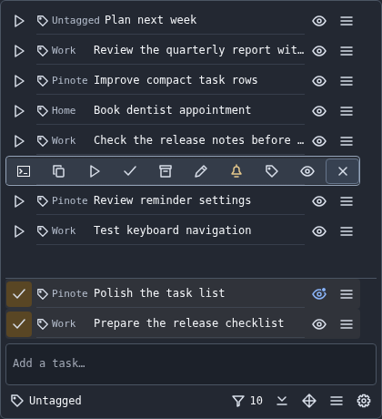
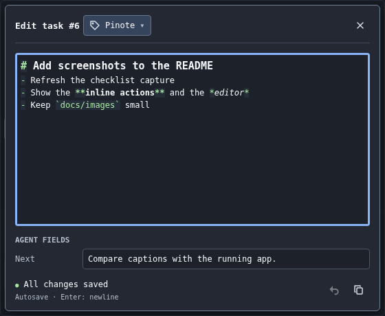

# pinote

Pinned desktop reminders with a small `note` CLI, stable IDs, and durable history.
Linux/i3 first, with Dunst notifications and an Electron desktop frontend for
editing, tags, progress, scheduled reminders, and archived tasks.


*In-progress tasks sit above the composer; the blue dot on an eye marks an unread
agent update.*

<details>
<summary>Inline task actions and the task editor</summary>



*Right-click the task text or use its Actions button to open the inline toolbar.*



*The editor styles Markdown source, autosaves, and edits Pi handoff fields.*

</details>

## Install

Requires **Node.js 22.19+** and npm. From a checkout:

```sh
npm --prefix backend ci --ignore-scripts
npm --prefix backend run build
./backend/bin/note --help
npm install -g ./backend   # optional: put `note` on PATH
```

Dunst (`dunstify`), a graphical session, and session D-Bus are needed only for
notifications. Installation never changes your shell, desktop configuration, or
existing reminders.

- **Electron:** see [installation, controls and limitations](docs/electron.md).
  It runs as a separate process, not a service, on the same task database. Only
  Linux/X11/i3 is a validation target.
- **Pi:** `pi install npm:pi-note`, then open **`/pinote`**. The
  [pi-note extension](pi/README.md) adds task menus, footer status, suggestions
  and handoff fields through the `note` CLI; it needs Pi 1.4.0+ and `note` on
  `PATH`. Completing a task from Pi closes Pi by default. Former HTTP-service users: follow the [migration steps](pi/README.md#migration).

## Use

```sh
note "check backups"                     # save and refresh the Dunst reminder
note                                    # list active notes
note list --json                        # machine-readable tasks for integrations
note start 2                            # mark a task in progress
note done 2                             # complete a task
note rm 3                               # archive, never erase
note restore 3                          # restore a task or clear its progress
note schedule 2 "2030-09-18 14:30"        # use a future local date/time
note reminders                          # list scheduled tasks
note history 3                          # inspect retained history
note --no-notify "GUI-only reminder"     # save without refreshing Dunst
```

See the [CLI and data guide](docs/usage.md) for all commands, Markdown
import/export, and scheduling rules, and [Electron controls](docs/electron.md#controls)
for desktop actions.

## Important constraints

- **Reminders are not wake-up alarms.** Due tasks return while the GUI is open,
  when it next opens/resumes, or when a `note` command runs. There is no timer
  service or automatic Dunst notification. GUI changes do not refresh Dunst.
- IDs and history are retained; completion and deletion are recoverable. The
  checklist's first-launch filter is **Untagged** and later launches restore your
  filter, so tagged tasks may be hidden until you change it.
- Data is saved before notification delivery. Do not repeat an add just because
  Dunst failed. Quote shell metacharacters; use `note add "done"` for reserved names.
- Notes default to `~/.local/share/pinote/notes.db`; logs to
  `~/.local/state/pinote/app.log` (XDG overrides supported). Data stays local but
  is **not encrypted**, and desktop notifications may remain in Dunst history.
- **Markdown exports are not backups:** they omit IDs, tags, schedules, agent
  fields, project selections, and history. Close Electron and stop CLI writes
  before copying `notes.db` and the `electron/` directory beside it; see
  [backup details](docs/usage.md#data-privacy-and-backup).
- Back up before upgrading, and update the CLI and Electron together. `note`
  versions before 0.25.0 cannot read schema 8; see the
  [upgrade guide](docs/usage.md#upgrading-for-scheduled-reminders).

## Development

See the [development guide](docs/development.md) for tests and architecture.

## License

[MIT](LICENSE).
